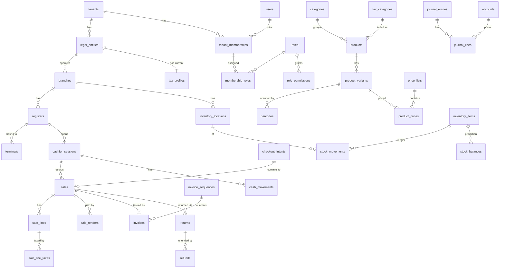

# 1POS — Data Model

Initial logical model. Tables are created per phase (vertical slices), not all up front. **Implemented** tables are marked ✅; everything else is design.

## Conventions (apply to every table)

| Rule | Implementation |
|---|---|
| PK | `id uuid PRIMARY KEY DEFAULT uuidv7()` |
| Tenant ownership | `tenant_id uuid NOT NULL REFERENCES tenants(id)`, `UNIQUE (tenant_id, id)` |
| Child → parent | composite FK `(tenant_id, parent_id) REFERENCES parent(tenant_id, id)` |
| RLS | `ENABLE` + `FORCE ROW LEVEL SECURITY`, policy `tenant_isolation` on `tenant_id = app_current_tenant_id()` |
| Money | `NUMERIC(20,4)` + `currency char(3)` on the document header |
| Quantity | `NUMERIC(18,4)`; rates `NUMERIC(9,6)` |
| Time | `timestamptz` (UTC); business-local `timezone text` on tenant/branch (default `Asia/Manila`); `business_date date` on sales/sessions |
| Audit columns | `created_at`, `created_by`, `updated_at` (mutable tables only) |
| State | `text` + `CHECK (status IN (...))`; transitions enforced in the domain service (and by trigger for immutable states) |
| Deletion | financial/inventory/audit tables: `UPDATE`/`DELETE` blocked by trigger; master data: `archived_at` |
| Snapshots | sale/invoice lines copy name, SKU, unit price, discount, tax rule version, taxable base, tax amount |

## ER diagram — Phase 1 & 2 core

## Table inventory by phase

| Phase | Tables |
|---|---|
| 1 Platform | ✅ `tenants`, ✅ `audit_logs` (Phase 0 foundation), ✅ `users`, ✅ `user_sessions`, ✅ `tenant_memberships`, ✅ `roles`, ✅ `permissions`, ✅ `role_permissions`, ✅ `membership_roles` (scope_type/scope_id — replaces the planned `membership_scopes`), `plans`, `subscriptions`, `entitlements`, ✅ `legal_entities`, `tax_profiles` (→ Phase 2), ✅ `branches`, ✅ `registers`, ✅ `terminals`, `categories`, `products`, `product_variants`, `barcodes`, `units_of_measure`, `price_lists`, `product_prices`, `tax_categories`, `tax_rules`, `idempotency_records`, `outbox_events` |
| 2 Retail engine | `checkout_intents`, `sales`, `sale_lines`, `sale_line_taxes`, `sale_tenders`, `payment_intents`, `payment_transactions`, `returns`, `return_lines`, `refunds`, `cashier_sessions`, `cash_movements`, `cash_reconciliations`, `invoice_sequences`, `invoices`, `invoice_lines`, `invoice_events`, `inventory_items`, `inventory_locations`, `stock_movements`, `stock_balances`, `customers` |
| 3 Inventory/purchasing/accounting | `suppliers`, `purchase_orders(+lines)`, `goods_receipts(+lines)`, `supplier_returns(+lines)`, `stock_transfers(+lines)`, `stock_counts(+lines)`, `stock_reservations`, `accounts`, `journal_entries`, `journal_lines`, `accounting_periods`, `posting_rules` |
| 4 Restaurant | `menus`, `menu_versions`, `menu_items`, `modifier_groups`, `modifiers`, `menu_item_modifier_groups`, `dining_areas`, `restaurant_tables`, `orders`, `order_lines`, `order_line_modifiers`, `kitchen_stations`, `order_tickets`, `ticket_items`, `recipes`, `recipe_versions`, `recipe_ingredients`, `service_charges` |
| 5 Offline/integration | `sync_batches`, `sync_events`, `terminal_sequences`, `webhook_events`, `integration_connections` |

## Data dictionary — implemented tables

### `tenants` ✅
| Column | Type | Notes |
|---|---|---|
| id | uuid PK | uuidv7 |
| slug | text UNIQUE | lowercase, used in URLs |
| name | text | display name |
| status | text | `PROVISIONING`, `ACTIVE`, `SUSPENDED`, `OFFBOARDING`, `CLOSED` |
| default_currency | char(3) | `PHP` |
| timezone | text | IANA, default `Asia/Manila` |
| created_at / updated_at | timestamptz | |

RLS: a tenant session sees only its own row (`id = app_current_tenant_id()`). Creation goes through `platform_create_tenant()` (SECURITY DEFINER, Phase 1).

### `audit_logs` ✅
Append-only (UPDATE/DELETE raise). `tenant_id` (nullable only for platform-level events — visible only to platform path), `actor_user_id`, `actor_type` (`USER`,`SYSTEM`,`SUPPORT`,`TERMINAL`), `action`, `resource_type`, `resource_id`, `correlation_id`, `metadata jsonb` (no PII/secrets), `occurred_at`.

## Index plan (initial)

| Table | Index | Access pattern |
|---|---|---|
| all tenant tables | `UNIQUE (tenant_id, id)` | composite FK target |
| barcodes | `UNIQUE (tenant_id, code) WHERE archived_at IS NULL` | scan lookup |
| products | `(tenant_id, lower(name) text_pattern_ops)`, trigram later | search |
| product_prices | `(tenant_id, price_list_id, variant_id, effective_from DESC)` | price resolution |
| sales | `(tenant_id, branch_id, business_date)`, `UNIQUE (tenant_id, terminal_id, terminal_txn_id)` | reports, dedupe |
| stock_movements | `(tenant_id, item_id, location_id, occurred_at)`, `(tenant_id, source_type, source_id)` | ledger/trace |
| stock_balances | `UNIQUE (tenant_id, item_id, location_id)` | row lock target |
| idempotency_records | `UNIQUE (tenant_id, scope, key)` | dedupe |
| outbox_events | `(status, available_at) WHERE status IN ('PENDING','RETRY')` | worker claim |
| journal_lines | `(tenant_id, account_id, entry_date)` | ledgers |
| audit_logs | `(tenant_id, occurred_at DESC)`, `(tenant_id, resource_type, resource_id)` | audit viewer |

## Migration strategy

- Location: `packages/database/drizzle/` (ordered, journaled by drizzle-kit). Generated DDL via `pnpm db:generate`; RLS/trigger/grant SQL via `drizzle-kit generate --custom` files edited by hand.
- Runner: `pnpm db:migrate` → `packages/database/src/migrate.ts`, connecting as **onepos_migrator**. Each migration runs in a transaction.
- Production policy: **forward-only**. No down migrations in prod. Recovery = a new corrective migration, or point-in-time restore for catastrophic cases.
- Expand/contract for breaking changes: add column/table → dual-write → backfill (batched job) → switch reads → drop in a later release.
- Every migration PR states: lock impact (avoid long `ACCESS EXCLUSIVE` on hot tables; `CREATE INDEX CONCURRENTLY` in a separate non-transactional migration), backfill plan, and forward-recovery step.
- CI runs all migrations on an empty database and runs the integration suite against it.
